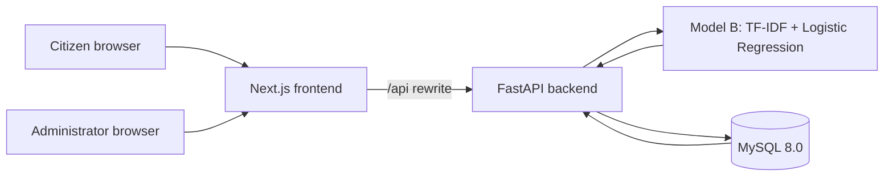

# GrievanceAI

GrievanceAI is an academic portfolio prototype for classifying fictional citizen grievances, recommending an illustrative department, storing submissions, tracking their status, and supporting an authenticated administration workflow. It is inspired by digital public-service systems, but it is not an official UIDAI or government application.

The application combines a Next.js interface, a FastAPI API, a TF-IDF and Logistic Regression classifier, and MySQL persistence. Machine-learning output is a recommendation for human review, not an automated official decision.

## Problem and proposed solution

Free-text complaints vary in wording and can be difficult to sort consistently. GrievanceAI accepts fictional complaint text, suggests a functional category and department, applies a simple priority rule, and saves the grievance in MySQL. Citizens receive an ID for tracking. An authenticated administrator can review and filter cases, update status, inspect analytics, and review activity logs.

## Key features

- Responsive homepage, grievance form, and tracking page
- TF-IDF and Logistic Regression classification using the active Model B artifact
- Top-three model scores and a provisional manual-review recommendation
- Illustrative department routing and rule-based priority
- MySQL-backed grievance records and tracking IDs
- Protected admin dashboard, filters, status updates, and analytics
- Paginated, filterable authentication and status-change activity logs
- Argon2 password verification, signed JWTs, HttpOnly cookies, origin checks, throttling, and revocable database sessions

## Technology stack

| Layer | Technologies |
| --- | --- |
| Frontend | Next.js 16, React 19, TypeScript, Tailwind CSS 4, Recharts, Lucide React |
| Backend | Python 3.10, FastAPI, Pydantic, SQLAlchemy, Uvicorn |
| Database | MySQL 8.0 with PyMySQL |
| Machine learning | pandas, scikit-learn, TF-IDF, Logistic Regression, Joblib |
| Authentication | Argon2id, PyJWT, HttpOnly cookies, database-backed session revocation |

## System architecture



The frontend proxies `/api/*` to FastAPI at `127.0.0.1:8000`. The backend loads `models/grievance_classifier.joblib` when its ML service starts. MySQL stores grievances, activity logs, and revocable admin sessions. See [Architecture](docs/ARCHITECTURE.md) for the verified request flows.

## Project structure

```text
GrievanceAI/
|-- backend/       FastAPI routes, services, SQLAlchemy models, and backend tests
|-- dataset/       Synthetic training, validation, and evaluation CSV files
|-- docs/          Architecture, demo, limitations, and screenshot guidance
|-- frontend/      Next.js application and package manifests
|-- models/        Active Model B and separate experimental artifacts
|-- notebooks/     Exploratory Jupyter notebook
|-- reports/       Model comparison, audit, and blind-test preparation records
|-- src/           ML preparation, training, evaluation, and comparison scripts
|-- .gitignore
|-- README.md
`-- requirements.txt
```

See the [Repository Audit](docs/REPOSITORY_AUDIT.md) for verified entry points, dependency files, test commands, documentation inventory, and Git-security findings.

## ML workflow

The active pipeline is defined by `src/finalize_model.py` and loaded by `backend/app/services/ml_service.py`:

1. Lowercase the complaint.
2. Remove characters outside `a-z`, digits, and whitespace, then normalize whitespace.
3. Transform text with TF-IDF using up to 1,000 unigram and bigram features.
4. Classify with balanced Logistic Regression.
5. Return the predicted category, illustrative department, and top three class scores.
6. Recommend manual review when the highest score is below 50% or the top-two margin is below 10 percentage points.

The scores are not calibrated probabilities and the review thresholds are provisional. Experimental artifacts remain under `models/`, but the application continues to load Model B from `models/grievance_classifier.joblib`.

### Six categories

1. Aadhaar Update
2. Authentication
3. Data Correction
4. Enrolment
5. General Query
6. Technical Issue

Department mappings are illustrative and are not official routing guidance.

## API overview

| Method | Endpoint | Access | Purpose |
| --- | --- | --- | --- |
| GET | `/` | Public | API status message |
| GET | `/health` | Public | Health response |
| POST | `/api/grievances/predict` | Public | Classify and save a grievance |
| GET | `/api/grievances/{grievance_id}` | Public | Track a grievance |
| GET | `/api/grievances/` | Admin | List and filter grievances |
| PATCH | `/api/grievances/{grievance_id}/status` | Admin | Change status and record the action |
| POST | `/api/admin/login` | Trusted origin | Establish an admin session |
| GET | `/api/admin/me` | Admin | Inspect the current session |
| POST | `/api/admin/logout` | Admin | Revoke the session and clear the cookie |
| GET | `/api/admin/analytics/summary` | Admin | Retrieve dashboard counts |
| GET | `/api/admin/activity-logs` | Admin | Paginate and filter audit records |

Interactive API documentation is available at `http://127.0.0.1:8000/docs` while FastAPI is running.

## Authentication and persistence

The prototype supports one configured administrator. Passwords are verified against an Argon2id hash. Login creates a short-lived signed JWT in a host-only HttpOnly cookie and a hashed, revocable session record in MySQL. Protected routes validate both the token and the live session. Login and authenticated mutations enforce trusted origins, and attempts are throttled per backend process. No password, raw JWT, or secret is returned to frontend JavaScript.

SQLAlchemy maps the application to `grievances`, `activity_logs`, and `admin_sessions`. Setup does not create, drop, migrate, or seed the existing grievance data. See [Admin authentication setup](backend/ADMIN_AUTH.md) for the existing provisioning workflow.

## Windows PowerShell setup

Prerequisites: Python 3.10, Node.js with npm, and MySQL 8.0 with the existing GrievanceAI schema.

```powershell
# Run these commands from the cloned repository root.
python -m venv venv
.\venv\Scripts\Activate.ps1
python -m pip install -r backend\requirements.txt
Set-Location frontend
npm install
Set-Location ..
```

The root `requirements.txt` adds notebook and ML exploration dependencies. Install it only when working on those scripts:

```powershell
python -m pip install -r requirements.txt
```

Keep these variable names in the project-root `.env`:

```text
DB_HOST
DB_PORT
DB_NAME
DB_USER
DB_PASSWORD
```

Admin provisioning stores these names in `backend/.env`:

```text
ADMIN_USERNAME
ADMIN_PASSWORD_HASH
ADMIN_JWT_SECRET
ADMIN_COOKIE_SECURE
ADMIN_ALLOWED_ORIGINS
```

Never commit either `.env` file. Only when admin authentication has not already been provisioned, run the documented hidden-prompt setup:

```powershell
.\venv\Scripts\python.exe -m backend.provision_admin
```

## Start the application

In elevated PowerShell, start MySQL if the installed service is named `MySQL80`:

```powershell
Start-Service MySQL80
```

Start FastAPI from the project root:

```powershell
.\venv\Scripts\python.exe -m uvicorn backend.app.main:app --reload --host 127.0.0.1 --port 8000
```

In another PowerShell window:

```powershell
Set-Location .\frontend
npm run dev
```

Open `http://localhost:3000`. Use that exact host and port for admin login because trusted origins are matched exactly.

## Tests and checks

Run the isolated backend workflow and authentication tests from the project root:

```powershell
.\venv\Scripts\python.exe -B -m unittest backend.test_admin_auth -v
```

They use an in-memory SQLite database and generated test credentials rather than the MySQL grievance tables.

Run frontend checks from `frontend/`:

```powershell
npm run lint
npm run build
```

Scripts under `src/` include model-development and evaluation utilities that can write artifacts or result CSVs. They are not routine application tests.

## Demo workflow

1. Submit a wholly fictional complaint from `/submit`.
2. Review the suggested category, department, priority, and review guidance.
3. Copy the grievance ID and retrieve it from `/track`.
4. Sign in at `/admin/login` with the locally provisioned administrator.
5. Review analytics and grievances, then change the fictional grievance status.
6. Confirm the transition appears in Activity Logs and analytics update.
7. Log out and confirm `/admin` requires authentication again.

See the [Demo Guide](docs/DEMO_GUIDE.md) for a complete walkthrough.

## Screenshots

Application screenshots have not been added. Capture the nine verified views listed in the [Screenshot Checklist](docs/screenshots/README.md) using fictional data and excluding credentials or tokens.

Suggested filenames are `01-homepage.png` through `09-analytics.png` under `docs/screenshots/`.

## Limitations

- This is a local academic/portfolio prototype, not a deployed or production-ready service.
- Demonstration and development data are synthetic or fictional.
- Model scores are uncalibrated and predictions require human judgment.
- Development validation influenced model development and is not an independent estimate of real-world performance.
- Department mapping and priority rules are illustrative.
- Authentication is designed for one local administrator; its in-process limiter is not a distributed control.
- Public tracking uses possession of the grievance ID rather than citizen accounts.
- Deployment would require HTTPS, shared rate limiting, secret management, monitoring, backups, accessibility/security review, and broader independent evaluation.

See [Project Limitations](docs/PROJECT_LIMITATIONS.md) for context.

## Privacy and fictional-data disclaimer

Use only fictional complaints and identities. Do not enter real Aadhaar numbers, biometric data, passwords, authentication codes, citizen records, or other sensitive personal information. GrievanceAI is not affiliated with UIDAI or any government agency.

## Future improvements

- Conduct a governed, independently authored and reviewed evaluation
- Calibrate confidence estimates and validate the manual-review policy
- Add a stronger citizen tracking-access design
- Replace the per-process login limiter with shared infrastructure
- Add HTTPS, observability, backups, migrations, and deployment automation
- Expand browser and MySQL integration coverage
- Perform accessibility, privacy, threat-model, and security reviews

## Author

Created as a personal portfolio project. No author profile link is currently present in the repository, so none is listed. Add only a verified GitHub or LinkedIn profile before publication.
