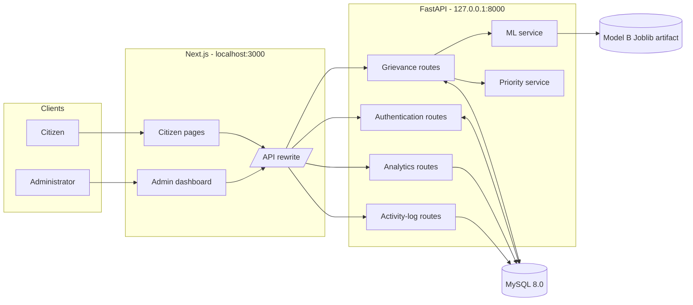
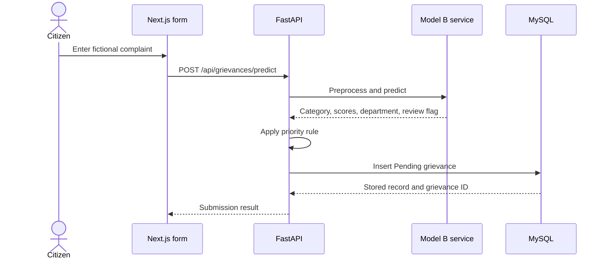

# GrievanceAI Architecture

This describes the implementation currently present in the repository. GrievanceAI is a local academic/portfolio prototype, not an official UIDAI or government system.

## Component view

## Verified entry points

- Frontend: `frontend/src/app/layout.tsx` and route pages under `frontend/src/app/`
- Frontend command: `npm run dev` from `frontend/`
- Backend: `backend/app/main.py`
- Backend command: `.\venv\Scripts\python.exe -m uvicorn backend.app.main:app --reload`
- Production ML loading: `backend/app/services/ml_service.py`
- Active artifact: `models/grievance_classifier.joblib`
- Database sessions: `backend/app/database/connection.py`

`frontend/next.config.ts` rewrites `/api/*` to `http://127.0.0.1:8000/api/*`. A specific grievance-list rewrite retains the trailing slash and avoids a redirect that could lose the admin cookie.

## Citizen submission

Complaint text must contain 5–2,000 characters. The backend creates IDs in `GRV-{year}-{number}` form based on existing records for that year. Despite its route name, the prediction endpoint also persists every accepted submission.

## ML classification

The ML service loads the saved pipeline once during module import. It lowercases text, removes non-alphanumeric characters other than whitespace, and normalizes whitespace. Model B contains a TF-IDF vectorizer and balanced Logistic Regression classifier. The service returns the predicted category and ranked scores, then applies an illustrative department mapping.

A separate keyword/category rule recommends High, Medium, or Low priority. Manual review is recommended when the top score is below 50% or the top-two margin is below 10 percentage points. The model scores are not calibrated probabilities.

## Tracking

The tracking page calls `GET /api/grievances/{grievance_id}` through the rewrite. FastAPI retrieves the MySQL record and returns the complaint, category, department, priority, status, and timestamps. The endpoint is public and access depends on possession of the grievance ID.

## Administrator authentication

1. The login page posts to `/api/admin/login` through the same-origin proxy.
2. FastAPI validates the exact Origin and applies a per-process attempt limit.
3. The password is checked against an Argon2id hash; the raw password is not stored.
4. A successful login inserts a hashed session identifier and expiry in `admin_sessions`.
5. A signed HS256 JWT is set as a host-only, HttpOnly, SameSite=Lax cookie scoped to `/api`.
6. Protected routes require both a valid JWT and a live, unexpired database session.
7. Logout deletes the database session before clearing the cookie.

Login, failed login, and logout events are written to `activity_logs`. The application does not store passwords or raw tokens in those records.

## Admin dashboard

After validating `/api/admin/me`, the dashboard loads the protected grievance list and analytics summary. It supports category and status filters. A status change calls `PATCH /api/grievances/{grievance_id}/status`; the grievance and `STATUS_UPDATE` activity record commit in the same transaction.

Analytics group current MySQL records by status, category, department, and priority. Activity logs are newest first, support `action_type` filtering, and use page/limit pagination.

## Persistence

| Table | Purpose |
| --- | --- |
| `grievances` | Complaint, prediction, department, priority, status, and timestamps |
| `activity_logs` | Authentication and status-change audit events |
| `admin_sessions` | Hashed session identifiers and expiration timestamps |

Database variables come from the root `.env`. Admin settings come from `backend/.env` with process-environment overrides. Neither file belongs in source control.

## Development assets

`src/`, `dataset/`, `notebooks/`, and `reports/` contain model development, evaluation, and audit material. Experimental artifacts are separate under `models/`. The backend still explicitly loads `models/grievance_classifier.joblib`.
